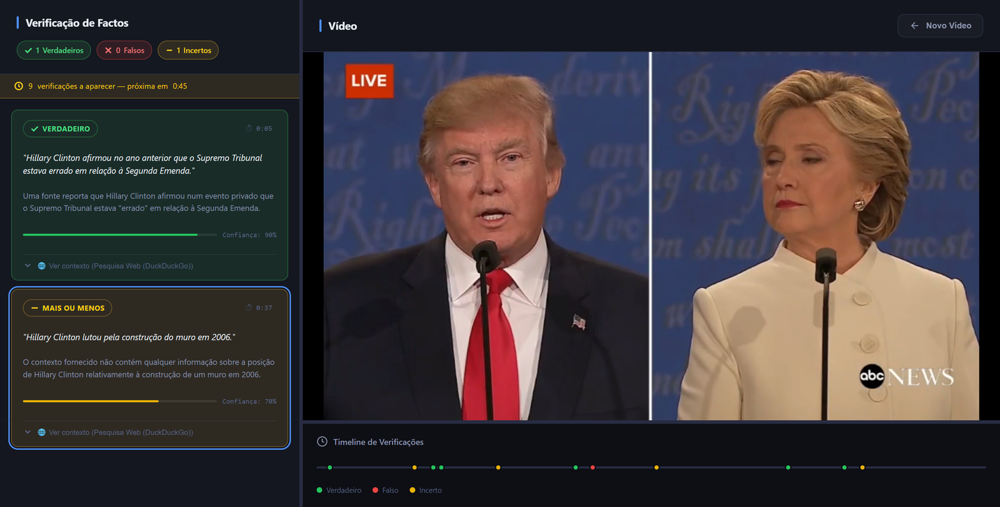
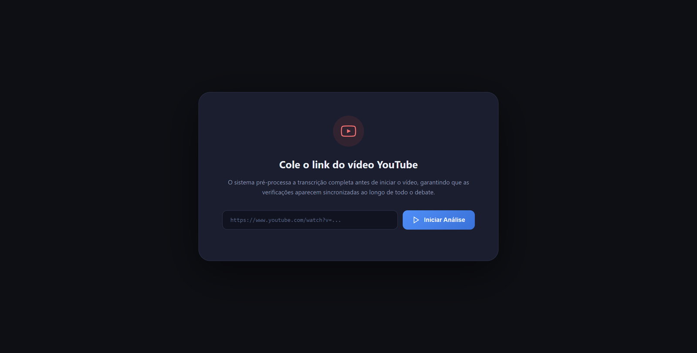
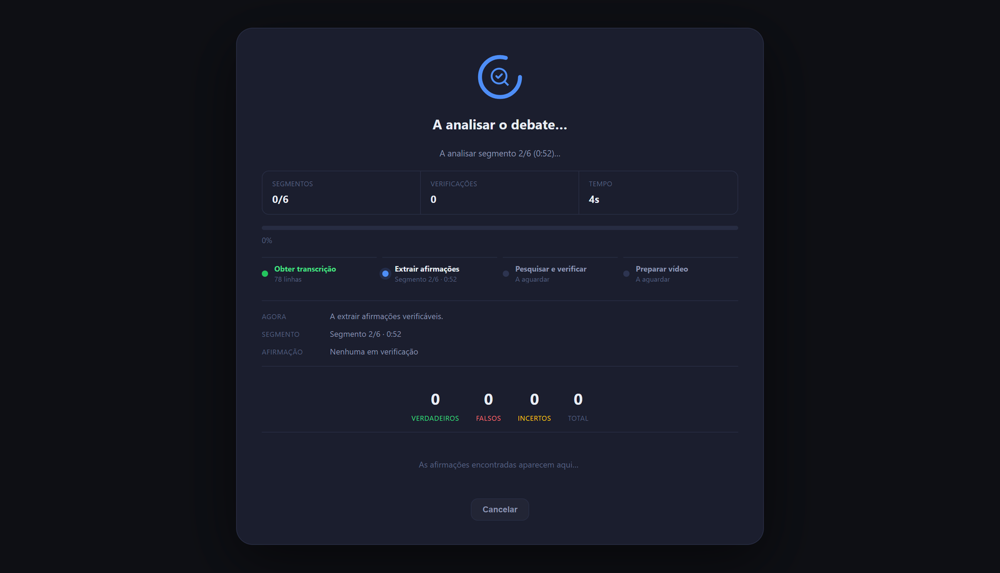

# FactCheck — Real-Time Fact-Checking of YouTube Videos with Local LLMs

**Paste a YouTube link. FactCheck pulls out the factual claims, checks them against web sources with a local LLM (RAG) and shows each verdict at the moment the claim is made in the video.**


> Academic project for the Applied Artificial Intelligence course (IAAPLI), BSc in Electrical and Computer Engineering, ISEP, 2026.
> **Authors:** Henrique Correia and Guilherme Leão.



## Highlights

- **RAG pipeline with a local LLM:**
  - one LLM pass extracts claims that can be checked;
  - a second pass judges each claim using live web results;
  - runs on **Ollama**, with no paid API and no data sent to an LLM provider.
- **Streaming results:**
  - a **FastAPI WebSocket** sends status, progress and each verdict as soon as it is ready;
  - the frontend plays the video and shows each verdict at its timestamp, with a timeline of results.
- **Concurrency without overloading the model:**
  - claim extraction and verification run in parallel under `asyncio` semaphores;
  - web searches run in a thread pool;
  - repeated claims are filtered out.
- **Context-aware chunking:** the transcript is split into overlapping chunks, so claims are not cut in half at the edges.
- **Calibrated output:** each verdict comes with a justification, sources and a confidence capped at 0.95.

## Results

The test case was a highlights video of the 2016 US presidential debate:

| Transcript segments | Claims verified | Total time |
|---|---|---|
| 78 | 10 | **33.6 s** |

The whole pipeline (transcript → claims → search → verdicts → synchronised playback) runs locally on consumer hardware.

## Prompt engineering and LLM robustness

**Structured outputs**
- Both LLM steps run with `temperature=0` and **JSON mode**.
- The claim extractor returns, for each claim:
  - the claim;
  - a search query;
  - the **exact transcript excerpt** it came from. This excerpt is what maps each claim back to its timestamp in the video and reduces misattribution.

**Scoped extraction**
- The prompt keeps only factual claims that can be checked.
- It drops opinions, slogans, promises, speculation and vague statements.

**Recovering from bad outputs**
- The JSON is recovered even when the model wraps it in extra text.
- Claims that are too short or narrative are filtered out.
- When the model fails on a whole chunk, extraction is **retried on smaller text windows**.

**No duplicates**
- Claims repeated across overlapping chunks, or rephrased by the LLM, are removed with a normalised similarity check before verification.

**Bounded latency**
- Each LLM call has a timeout and a cap on generated tokens.
- Concurrency is limited with semaphores, so a slow model never blocks the stream.

## Evidence retrieval and source ranking

Each claim is searched with a few **query variants**: the generated query plus one built from the quoted transcript excerpt. Results are cached in memory and ranked with a credibility heuristic before they reach the LLM:

| Signal | Effect |
|---|---|
| Fact-checking organisations, established media, government domains | Strong boost |
| Results mentioning "fact check" or "debate" | Moderate boost |
| Overlap between query terms and the result | Proportional boost |
| Low editorial-quality domains | Penalty |
| Wikipedia and YouTube | Partial penalty, to avoid relying on them too much |

## How it works

```text
YouTube URL
   │
   ▼
Transcript (youtube-transcript-api) ──► overlapping chunks
   │
   ▼
Claim extraction (LLM via LangChain + Ollama)          ┐
   │                                                   │ parallel, limited
   ▼                                                   │ by semaphores
Web search per claim (DuckDuckGo, query variants)      │
   │                                                   │
   ▼                                                   │
Verdict with RAG (LLM + retrieved sources)             ┘
   │
   ▼
WebSocket stream ──► frontend synchronised with the YouTube player
```

| 1. Paste the link | 2. Live analysis |
|---|---|
|  |  |

### Verdicts

| Verdict | Meaning |
|---|---|
| **True** (*Verdadeiro*) | Explicitly confirmed by the sources |
| **False** (*Falso*) | Explicitly contradicted by the sources |
| **Uncertain** (*Mais ou menos*) | Not enough context, weak sources, opinion or an ambiguous claim |

The interface and verdicts are in Portuguese. The model analyses each video in its own language.

## Tech stack

| Layer | Technology |
|---|---|
| Backend | Python 3.12, FastAPI, Uvicorn, asyncio |
| Real time | WebSockets |
| LLM | Ollama (any local model, e.g. `llama3.2`, `phi4`) |
| Orchestration | LangChain, `langchain-ollama` |
| Retrieval | DuckDuckGo search (`ddgs`, no API key) |
| Transcripts | `youtube-transcript-api` |
| Frontend | HTML, CSS, JavaScript, YouTube IFrame Player |

## Getting started

Requires Python 3.12+ and **[Ollama](https://ollama.com/)** running locally with a model pulled, for example `ollama pull llama3.2`.

```bash
git clone https://github.com/henrique-correia-it/factcheck.git
cd factcheck
python -m venv .venv
source .venv/bin/activate        # Windows: .venv\Scripts\activate
pip install -r requirements.txt
cp .env.example .env             # set LLM_MODEL (and OLLAMA_BASE_URL if needed)
cd backend
python main.py
```

Open <http://localhost:8000>. The video needs captions (manual or automatic) available on YouTube.

### Configuration (`.env`)

| Variable | Default | Description |
|---|---|---|
| `OLLAMA_BASE_URL` | `http://localhost:11434` | Ollama server URL |
| `LLM_MODEL` | — | Ollama model to use |
| `CHUNK_SIZE` / `CHUNK_OVERLAP` | `16` / `3` | Transcript segments per chunk and overlap between chunks |
| `CHUNK_CONCURRENCY` | `2` | Chunks analysed at the same time |
| `FACT_CHECK_CONCURRENCY` | `2` | Verification batches in parallel |
| `WEB_SEARCH_CONCURRENCY` | `4` | Parallel web searches per batch |
| `LLM_TIMEOUT_SECONDS` | `45` | Timeout per LLM call |

With large models or a small GPU, lower `CHUNK_CONCURRENCY` to `1`.

## WebSocket protocol

Endpoint: `/ws/factcheck`

```json
// client → server
{ "url": "https://www.youtube.com/watch?v=VIDEO_ID" }

// server → client
{ "type": "status",     "message": "...", "stage": "transcript" }
{ "type": "ready",      "total_chunks": 12, "video_duration": 3600 }
{ "type": "progress",   "current": 3, "total": 12, "timestamp": 120.5 }
{ "type": "fact_check", "timestamp": 142.0, "claim": "...", "verdict": "Verdadeiro",
  "justification": "...", "confidence": 0.87, "sources": ["..."] }
{ "type": "complete",   "total_claims": 24, "elapsed_seconds": 87.3 }
{ "type": "error",      "message": "..." }
```

## Project structure

```text
backend/
├── main.py                FastAPI app, WebSocket endpoint, concurrency control
├── transcript_handler.py  transcript download and parsing
├── claim_extractor.py     claim extraction with the LLM
├── web_search.py          DuckDuckGo search
├── rag_pipeline.py        verification: retrieval + LLM verdict
└── analysis_log.py        structured per-session log
frontend/
├── index.html             single page, three screens
├── script.js              WebSocket client and synchronised player
└── style.css
```

## Limitations and roadmap

FactCheck is a working prototype, not a production fact-checker. It supports human judgement; it does not replace it.

**Known limitations**
- Verdicts depend on search snippets and on the model used.
- There is no labelled evaluation set yet.
- Speaker misattribution can happen in debates.
- Videos without captions cannot be analysed.

**Roadmap**

| Improvement | Why |
|---|---|
| Labelled dataset with precision, recall and a confusion matrix | Objective evaluation of verdict quality |
| Full-page retrieval instead of snippets | Better evidence |
| FAISS index with embeddings and a persistent cache | Semantic retrieval, less dependence on live search |
| Speaker diarisation | Fewer attribution errors in debates |
| Automated tests and Docker | Reproducibility and protection against regressions |
